# Functionallity:

## Home Screen

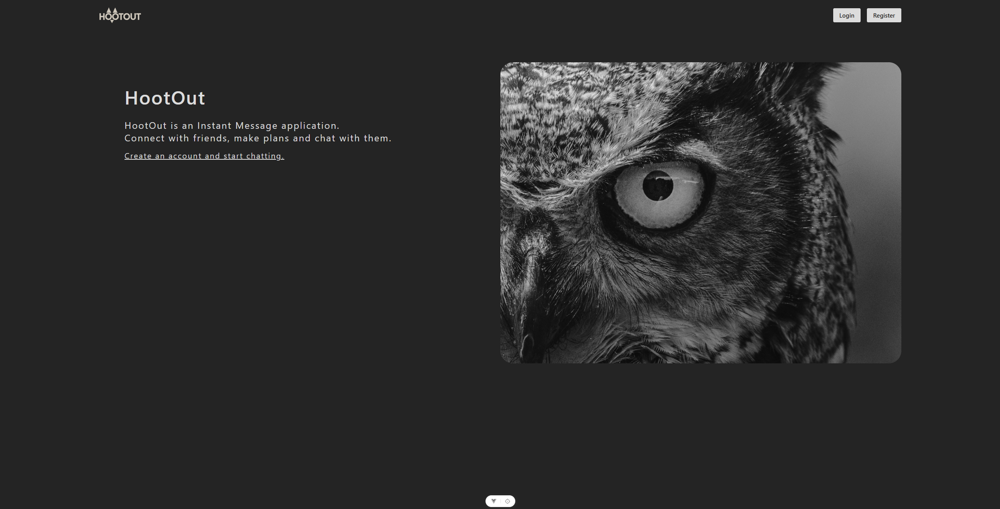
Home Screen with links to the Login and Register Page

## Register and Login:

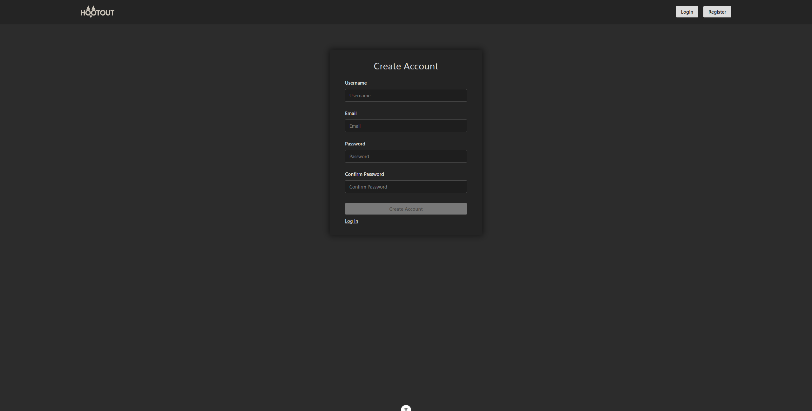

Users can create an account with an email, username and password.

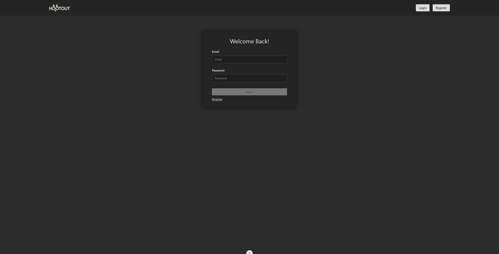
Users can Login with an email and password. They can Log out at any time.

## Create Server:

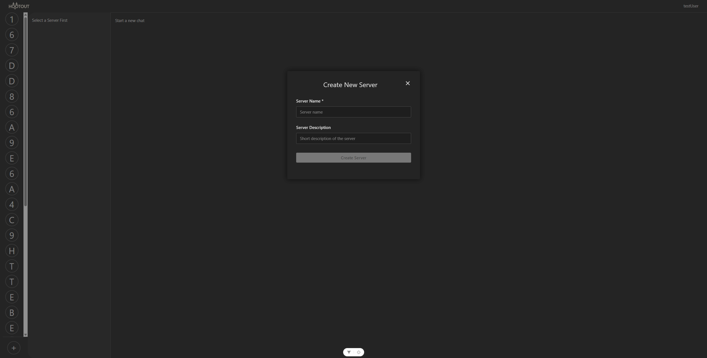
Users can create a Server. A server must have a name and an optional description.

## Create, update, delete Channels:

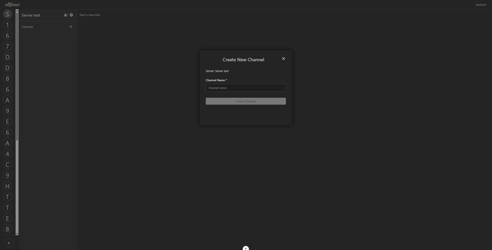
Users inside a Server can create a new Channel. A Channel has only a name.

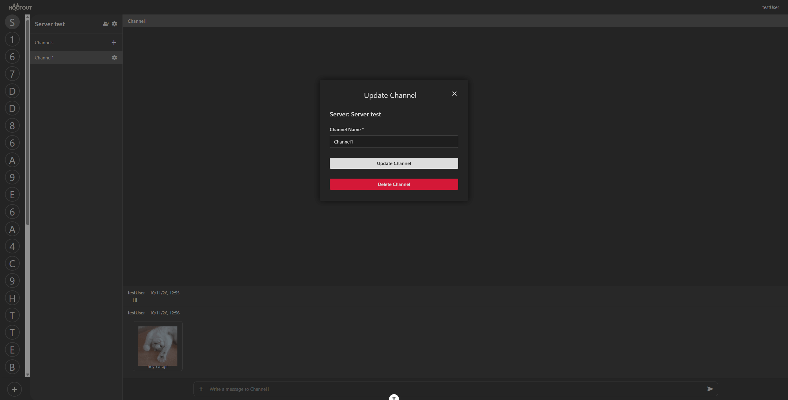
After creating a Channel, users can update the Channel name and delete the Channel

## Sending Messages:

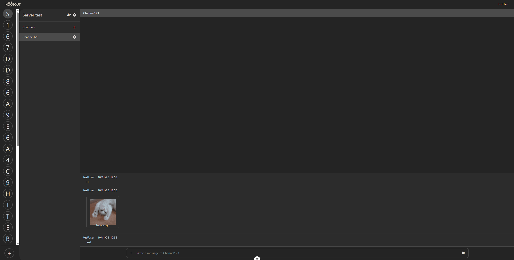
Users can send messages in the Channels of the Server they are part of. Each channel has their own separate messages.

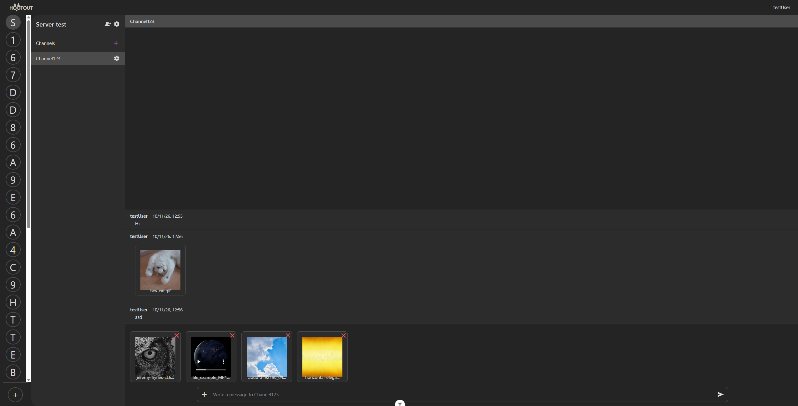
Inside a Channel, Users can also add attachments to their messages. They can attach images, videos, audio and document files. They can preview, add or remove them to the message.

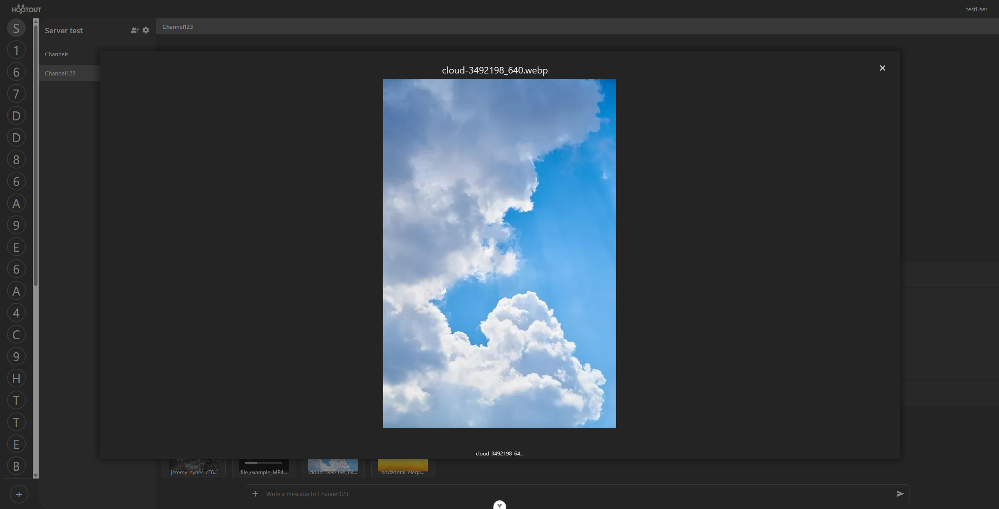
Before and after sending the message, Users can open the file preview modal by clicking the image "miniature".

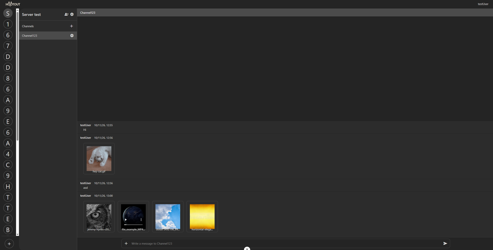
After sending a message with attachments, the file preview will show on the chat.

## Server Members:

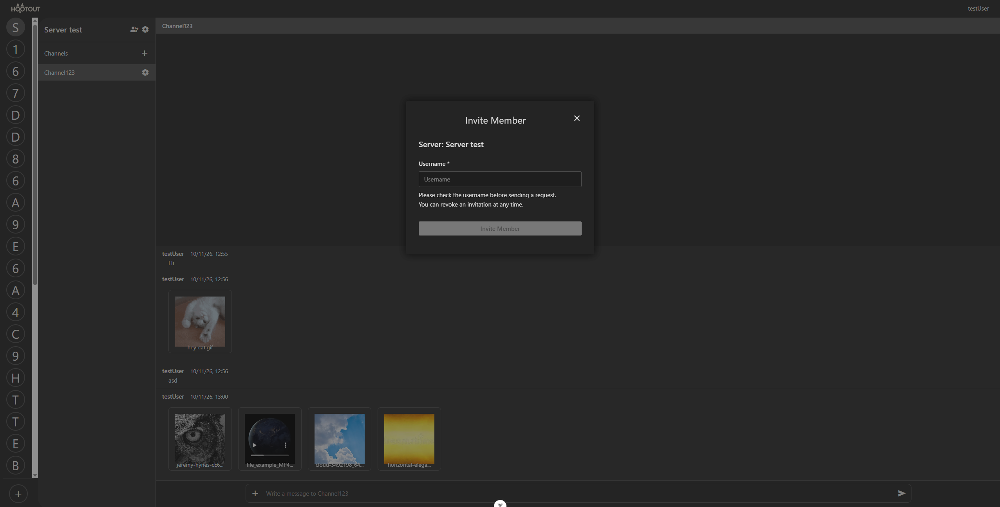
Users can invite other Users to a Server. They can invite them with their username. Invited Users can accept or reject the invitation to become members of the Server. Also members of a Server can revoke the Server invitation.

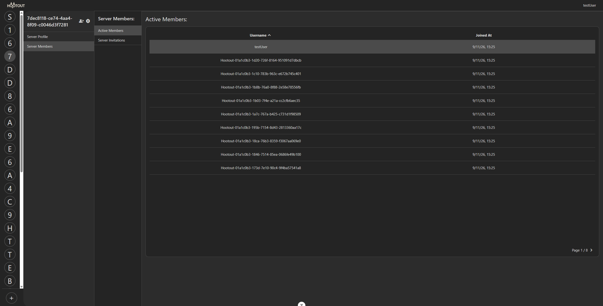
On the Server settings, Users can see the list of Server members, and when they joined the Server.

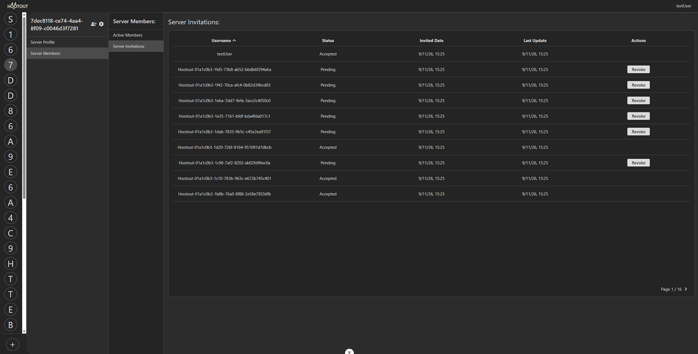
On the Server settings, Users can also see the list of Server invitations. They can revoke any pending invitation

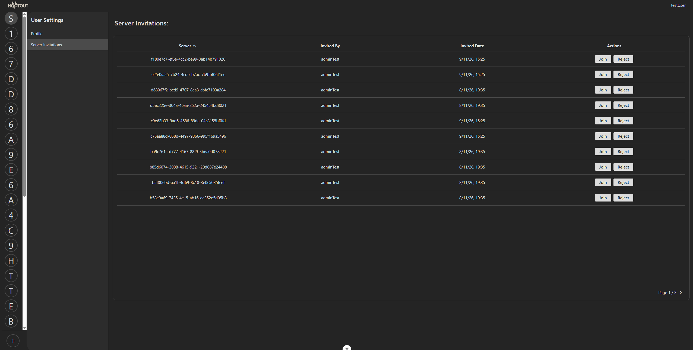
To accept a Server invitation, User can go to the User settings and see the list of invitations that they have. They can join the Server or reject the invitation.

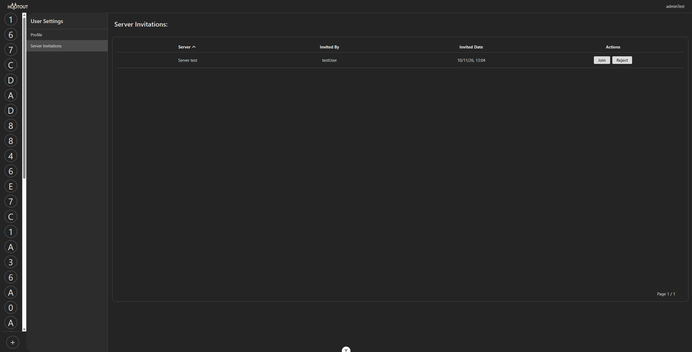
This is how it will appear when the User "adminTest" was invited to the Server "Server test"

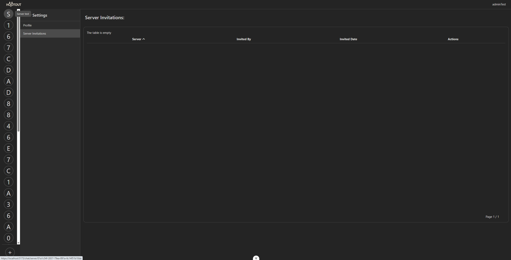
After accepting an invitation, it will appear on the Server list.

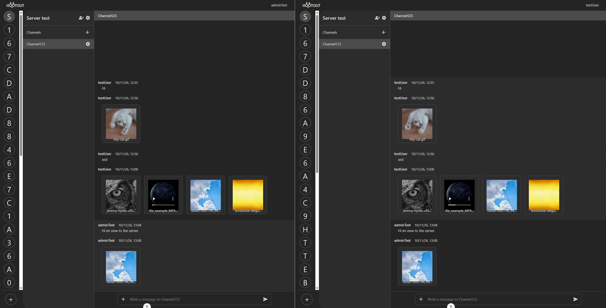
After joining the Server, Users can send messages in real time

## Server Profile:

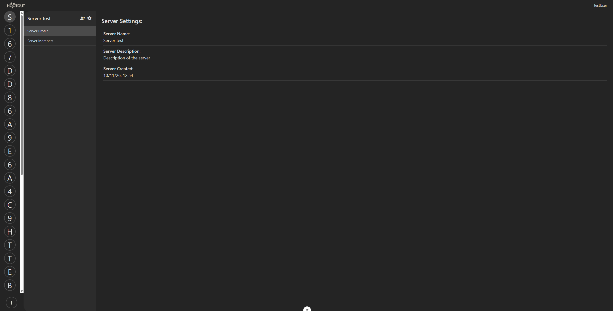
On the Server settings, Users can see the Server profile

## User Profile:

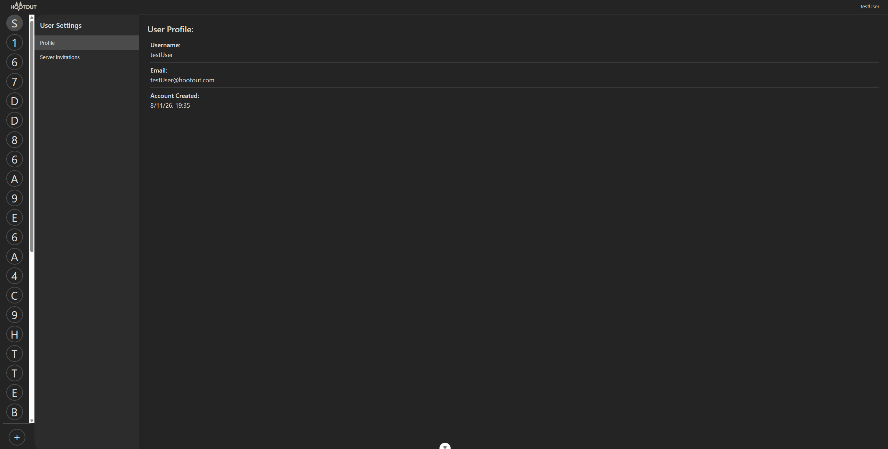
On the User setting, Users can see their own User profile

## Mobile view:

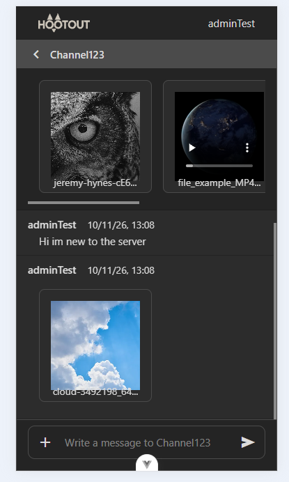
All pages are responsive to smaller screen sizes. For example this is how the Chat is shown on a small screen size
